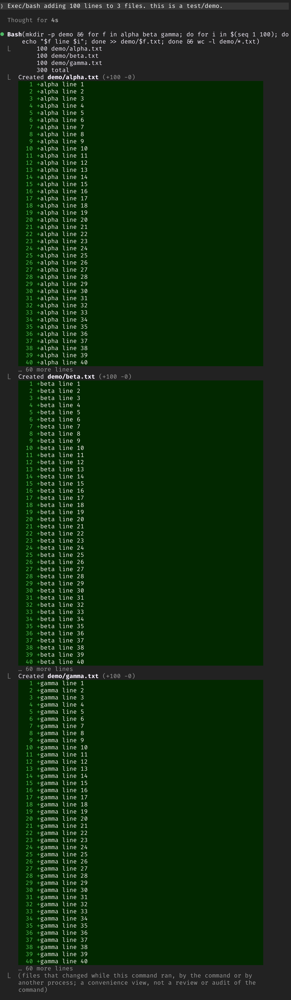
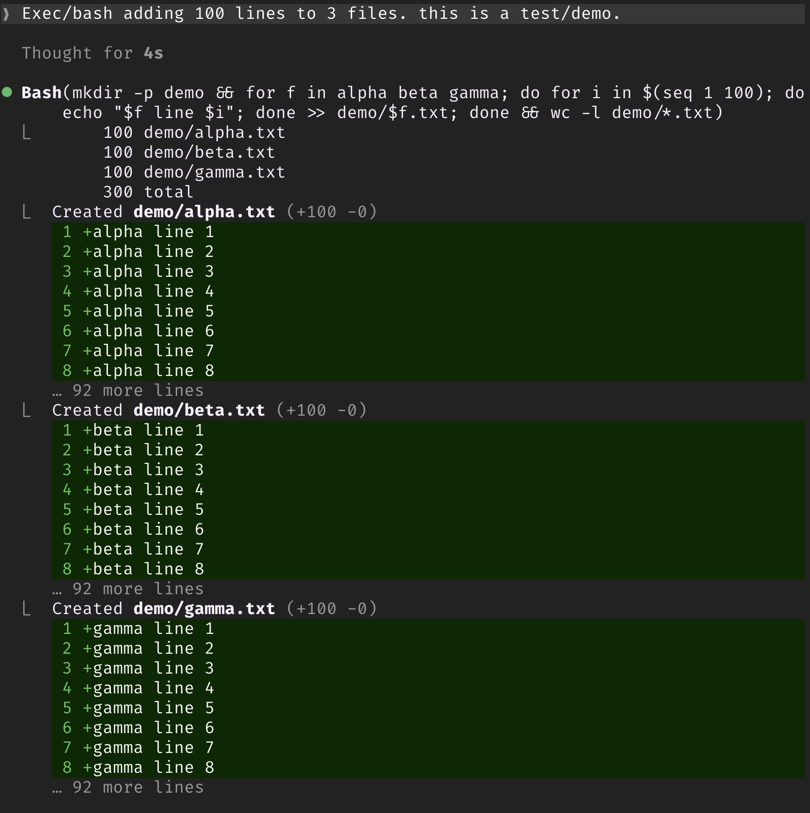

# fix-bash-diffs

**Stop Bash file diffs from flooding your Claude Code transcript.**

- **The problem:** when a Bash command creates or edits files in a git repo, Claude Code shows up to 40 diff lines per file, with no setting to change it. Writing a new file with the Write tool shows 10.
- **The fix:** this mod shows the first 8 lines of each file, keeps the file's real `(+N -M)` count, and adds `… N more lines` under it.
- **Untouched:** Edit and Write, and Bash commands whose files fit in 8 lines.

<table>
  <tr>
    <th>Without the mod</th>
    <th>With the mod</th>
  </tr>
  <tr>
    <td valign="top"></td>
    <td valign="top"></td>
  </tr>
  <tr>
    <td colspan="2">The same command, creating three 100-line files.</td>
  </tr>
</table>

Only the drawing changes: what the model sees is untouched.

### What you give up on a cut row

To keep each file's count right, the mod draws a cut row's files itself rather than handing Claude Code a shortened diff (which it would count from). On those rows:

- ctrl+o does not expand the files to their full diff; `/fix-bash-diffs` off does.
- The diff is drawn with the plugin API's diff element, so its gutter can differ slightly from Claude Code's own.
- Paths are shown relative to the session's folder, which is close to, but not exactly, how Claude Code shortens them.
- Claude Code's one-time note on its first file diff ("files that changed while this command ran…") is not shown.

## Install

At the prompt of a Claude Code terminal session:

```
/plugin install fix-bash-diffs --marketplace adrienbrault/claude-fix-bash-diffs
```

Answer `y` to add the marketplace, then pick a scope.

Or from a shell:

```sh
claude plugin marketplace add adrienbrault/claude-fix-bash-diffs
claude plugin install fix-bash-diffs@fix-bash-diffs
```

Either way, it loads in the next session you start.

### Update or remove

```sh
claude plugin marketplace update fix-bash-diffs
claude plugin update fix-bash-diffs@fix-bash-diffs   # then restart the session

claude plugin uninstall fix-bash-diffs@fix-bash-diffs
```

## Use

`/fix-bash-diffs` turns the cut off and on again for the current session, so you can compare. Rows already on screen redraw.

Claude Code only draws Bash file diffs when the session runs in a git repository, so that is where the mod has something to cut.

To change the limit, edit `MAX_LINES` in `hooks/register.tsx`.

## Requirements

Built and tested on Claude Code 2.1.303. It uses the plugin hooks API, which is early access, and reads the per-file diff Claude Code attaches to a Bash result, an internal field. Either can change in a later release; if Bash rows stop being cut, that is the likely reason.

## Develop

```
claude --plugin-dir /path/to/claude-fix-bash-diffs
claude plugin validate /path/to/claude-fix-bash-diffs
claude plugin test /path/to/claude-fix-bash-diffs
```

## License

MIT
