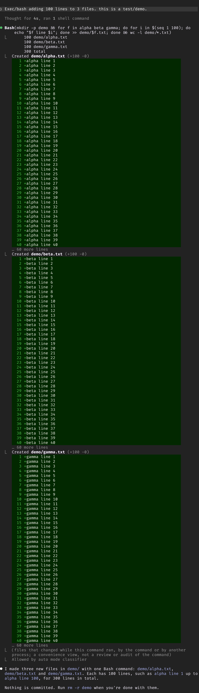
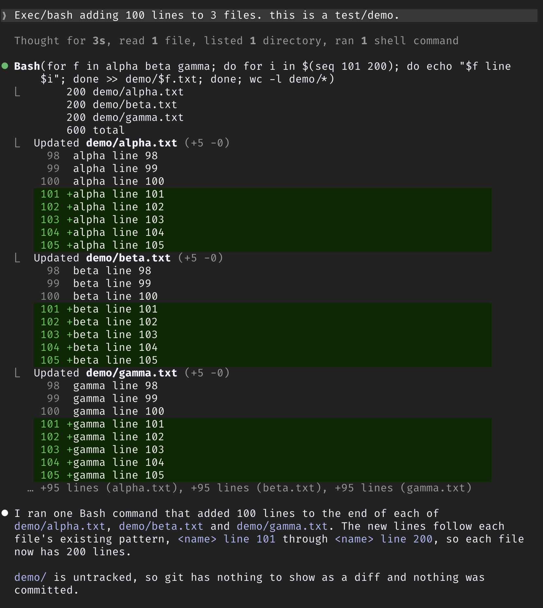

# fix-bash-diffs

A Claude Code mod that keeps file-changing Bash commands from flooding the transcript.

When a Bash command creates or edits files, Claude Code draws up to 40 diff lines per file under the call, and has no setting to change that. Write's preview stops at 10 and an Edit shows just its change and a little context, so a single `cp` or `cat > file` touching a few files can fill several screens.

This mod shows the first 8 diff lines of each file and ends the row with one dim line saying what was cut:

```
… +59 lines (setup.py), +6 lines (config.json), +35 lines (deploy.sh)
```

<table>
  <tr>
    <th>Without the mod: one command creating three 100-line files</th>
    <th>With the mod: one command adding 100 lines to each</th>
  </tr>
  <tr>
    <td valign="top"></td>
    <td valign="top"></td>
  </tr>
</table>

Edit and Write rows are left alone. Only the drawing changes: what the model sees is untouched.

## Install

At the prompt of a Claude Code terminal session:

```
/plugin install fix-bash-diffs --marketplace adrienbrault/claude-fix-bash-diffs
```

Answer `y` to add the marketplace, then pick a scope.

## Use

`/fix-bash-diffs` turns the cut off and on again for the current session, so you can compare. Rows already on screen redraw.

Claude Code only draws Bash file diffs when the session runs in a git repository, so that is where the mod has something to cut.

To change the limit, edit `MAX_LINES` in `hooks/register.tsx`.

## Develop

```
claude --plugin-dir /path/to/claude-fix-bash-diffs
claude plugin validate /path/to/claude-fix-bash-diffs
claude plugin test /path/to/claude-fix-bash-diffs
```

## License

MIT
